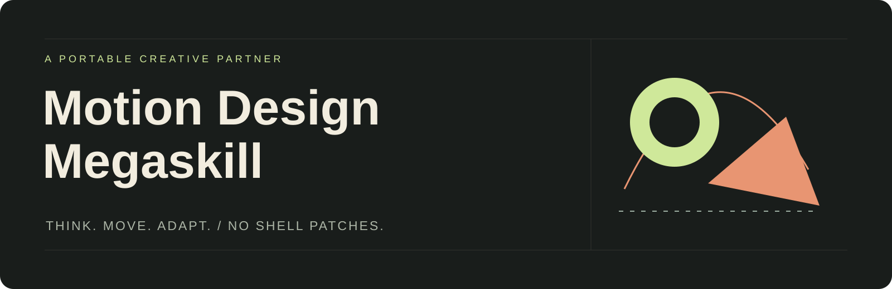
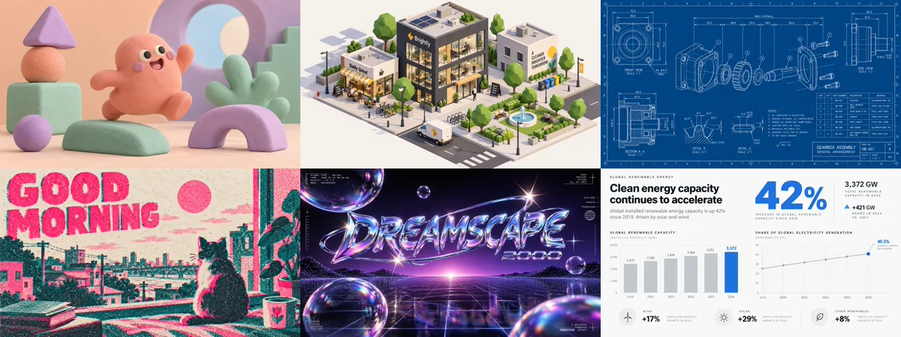

<div align="center">



# Идея → движение → собственный визуальный язык

**Переносимый скилл-партнёр по моушен-дизайну.**
Не заставляет менять харнесс. Помогает придумать, выбрать, собрать и проверить.

[Скачать скилл ZIP](https://github.com/cwjechw98-lang/motiondesigne-megaskill/releases/download/v1.0.0/motion-design-megaskill-v1.0.0.zip) · [English](README.en.md) · [Начать](#начать) · [Галерея](#атлас-направлений) · [Установка](docs/INSTALLATION.md) · [Как устроено](docs/ARCHITECTURE.md)

**21 направление · 3 варианта пространства · локальная галерея · без обязательных зависимостей**

</div>

---

## Не просто коллекция промптов

Этот навык дополняет уже существующего агента — не заменяет его роль и память. При вызове агент помогает воспользоваться возможностями: предлагает реализации под ваш запрос, объясняет разницу и рекомендует подходящую. Если идея уже ясна, не превращает работу в анкету.

| Что вы хотите | Как помогает агент |
|---|---|
| «Хочу ролик, но не знаю какой» | Уточняет смысл и аудиторию, предлагает разные художественные решения |
| «Нравится такой стиль» | Помогает выбрать направление, адаптирует его к вашему сюжету |
| «Не хочу шаблон» | Выводит материал, ритм и движение из идеи, комбинирует приёмы |
| «Хочу библиотеку внутри моего агента» | Изучает возможности среды и предлагает безопасный способ интеграции |
| «Нужен готовый ролик» | Использует имеющийся рендерер, проверяет результат или честно обозначает ограничения |

## Начать

Передайте агенту корень этой папки как навык по правилам вашей среды. Универсальная точка входа — [`SKILL.md`](SKILL.md); подробности в [инструкции установки](docs/INSTALLATION.md).

Затем напишите:

> Используй motion-design-megaskill. Хочу короткий ролик о том, как хаос превращается в ясный план. Предложи разные идеи, порекомендуй подходящую и помоги реализовать её доступными здесь инструментами.

Или:

> Используй motion-design-megaskill. Не выбирай готовый пресет: придумай собственный визуальный язык для моего сюжета. Объясни, как материал и движение передают смысл.

Для интеграции:

> Изучи возможности моего харнесса и предложи оптимальный способ пользоваться галереей этого навыка. Не меняй файлы приложения. Если встроенная панель не поддерживается безопасно, оставь обычную локальную галерею.

**Важное различие:** создание ролика не запускает переустановку оболочки. Интеграция — отдельный, необязательный запрос.

## Атлас направлений



Откройте **[`gallery.html`](gallery.html)** из скачанной папки обычным браузером. Работает локально, без сервера, CDN, шрифтов из сети и API-ключей. На странице файла GitHub HTML не исполняется — сначала скачайте или клонируйте репозиторий.

Поиск и фильтры помогают выбрать направление. В карточке можно добавить пространственный модификатор и свой бриф, затем скопировать промпт. Прямой отправки сообщения или запуска рендера нет.

| Базовые техники | Экспериментальные направления |
|---|---|
| Живая линия · бумажная сцена · геометрический вектор | Швейцарская сетка · пластилиновый мир · изометрия |
| Графический панч · пиксельная механика · слова как действие | Объёмная типографика · инженерный чертёж · ризограф |
| Световая схема · скульптурный объект · продуктовая история | Y2K · тактильный стоп-моушен · управляемый глитч |
| Пространство отдельно: 2D / 2,5D / 3D | Материал и физика · данные в движении · кинетическая матрица |

**Превью статические.** Базовые иллюстрации — наши SVG, экспериментальные — AI-изображения, созданные для этой библиотеки. Это не проверенные ролики и не чужие работы, скачанные из галерей. Цифры на картинках не являются данными.

## Главное — уметь работать без пресета

[`references/creative-grammar.md`](references/creative-grammar.md) учит строить язык по смыслу: драматургический глагол → материал → закон движения → пространство → типографика → ограничения.

Пресет — отправная точка, а не потолок. Одна идея может стать бумажной механикой, тяжёлой металлической сборкой или типографическим превращением; навык помогает объяснить, **почему** выбранное решение подходит сюжету.

Другие модули загружаются по задаче, а не целиком в каждом запросе: [производство и проверка](references/render-and-review.md), [пополнение библиотеки](references/preset-authoring.md), [источники и границы исследования](references/research-notes.md).

## Не ломать оболочку ради библиотеки

```text
Пользовательский каталог навыков
└── motion-design-megaskill/   ← инструкции, знания, данные, галерея

Пользовательское хранилище
├── свои рецепты и избранное  ← отдельно от обновляемого релиза
└── необязательный адаптер   ← штатный API текущего харнесса

Установочный каталог харнесса ← не трогаем
```

Агент выбирает минимальный достаточный вариант: обычная галерея → штатный просмотр артефакта → пользовательская команда → документированный плагин/панель. Нельзя предполагать наличие API или обещать панель до проверки.

Отдельный пользовательский пакет не зависит от патчей `node_modules` или web-сборки. **Это снижает хрупкость, а не гарантирует вечную совместимость:** если API расширений изменится, адаптер может потребовать обновления; навык, знания и локальная галерея останутся отдельными файлами.

Подробнее: [принципы интеграции](references/integration-playbook.md) и [контракт необязательного моста](docs/integration-contract.md). Универсальный готовый host-плагин в комплект не входит.

## Установка и проверки

Для ручной установки достаточно скопировать папку в поддерживаемый вашей средой пользовательский каталог навыков. Не копируйте `.git`, тестовые артефакты и чужие секреты. Если нужен безопасный локальный установщик, он требует **Node.js 20+** и явный целевой каталог:

```sh
node scripts/install.mjs --help
node scripts/install.mjs --target "<полный-каталог-навыка>" --dry-run
node scripts/install.mjs --target "<полный-каталог-навыка>"
```

Существующая папка по умолчанию не заменяется. Для обновления есть `--replace` с предварительной резервной копией; детали и ограничения — в [INSTALLATION.md](docs/INSTALLATION.md). Не требуется пакетный менеджер или сетевой install.

Проверка пакета:

```sh
node --test
node scripts/validate.mjs
```

Проверяются комплектность, пути, данные, установка и восстановление после ошибок. CI настроен для Linux, Windows и macOS на Node 20/22/24; настройка матрицы **не означает, что все эти среды уже проверены локально**. Автообнаружение навыков и интеграцию в конкретный харнесс нужно тестировать отдельно.

## Происхождение и лицензия

Первичное вдохновение — [урок VIZAVI](https://vizavi.academy/lesson-motion/). Дополнительные материалы — Codrops, Animography и Motionographer; объём фактического изучения указан в [исследовательских заметках](references/research-notes.md).

**Это независимый проект, не официальный продукт VIZAVI.** Оригинальный архив, его инструкции, дословные пресеты и исходные картинки не распространяются. Все рецепты в этом репозитории написаны самостоятельно; сведения о правах и ограничениях AI-изображений — в [`NOTICE.md`](NOTICE.md).

Код и документация: [MIT](LICENSE). Участие: [CONTRIBUTING.md](CONTRIBUTING.md). Безопасность: [SECURITY.md](SECURITY.md).
