# Каталог направлений

Все рецепты в этом пакете написаны самостоятельно. Векторные превью созданы для библиотеки; изображения экспериментальных направлений сгенерированы ИИ. Это статические примеры, не проверенные ролики. Сторонний архив и оригинальные изображения VIZAVI не включены.

Откройте [галерею](../gallery.html), выберите направление, добавьте бриф и скопируйте промпт. Для собственной композиции прочитайте [грамматику](creative-grammar.md).

## 01-handdrawn — Живая линия
Коллекция: Базовые техники. Превью: авторский SVG.
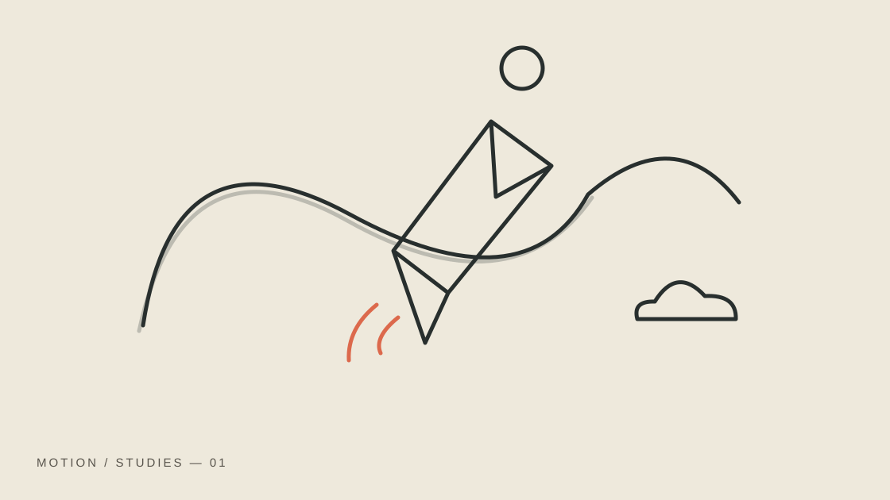

Построй сцену несколькими неровными линиями на светлом поле. Штрих возникает вслед за действием: намечает путь, превращается в объект и оставляет осмысленный след. Небольшая разница между повторными контурами даёт ручной характер; не подменяй рисунок обводкой печатного шрифта.

## 02-paper — Бумажная сцена
Коллекция: Базовые техники. Превью: авторский SVG.
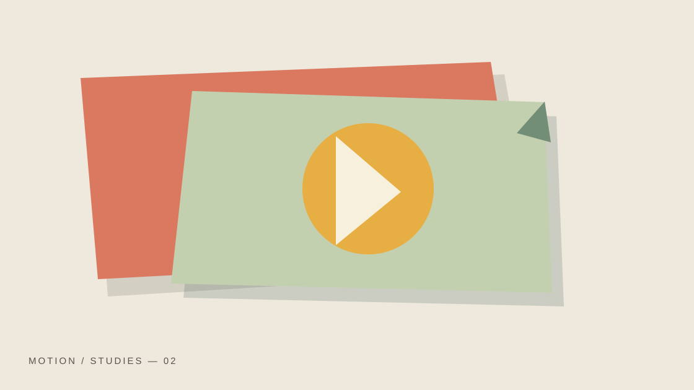

Используй вырезки, сгибы и перекрывающиеся цветные листы. Контактные тени показывают, какой слой лежит выше. Пусть смысл рождается из сборки, раскрытия или переворачивания бумаги; жёсткие части сохраняют форму, сгибаются только нужные участки.

## 03-vector — Геометрический вектор
Коллекция: Базовые техники. Превью: авторский SVG.
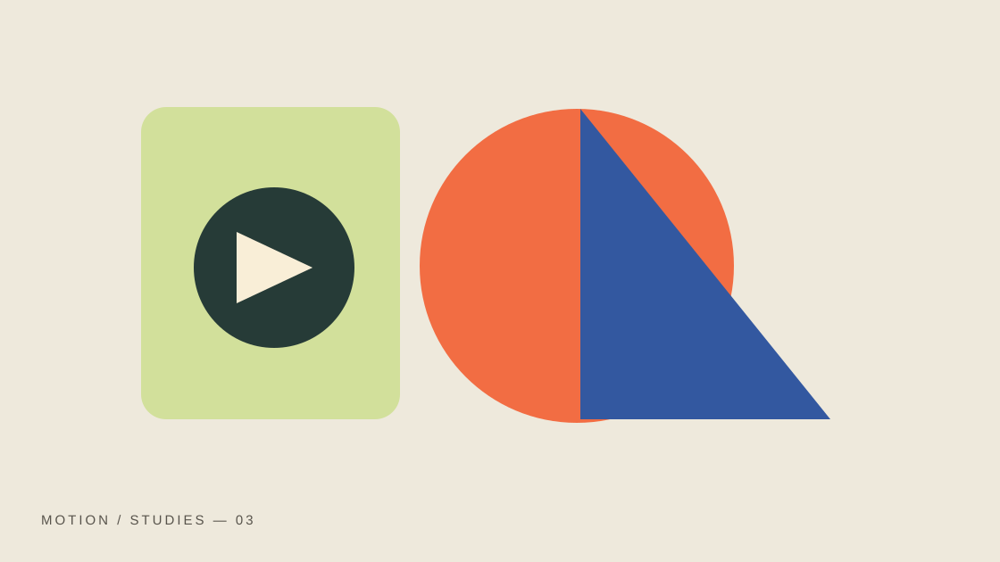

Собери ясную композицию из простых заливок и ограниченной палитры. Изменение положения, размера и формы объясняет действие, а не заполняет паузу. Зафиксируй оси и порядок появления; ровные контуры и свободное пространство удерживают читаемость.

## 04-comic — Графический панч
Коллекция: Базовые техники. Превью: авторский SVG.
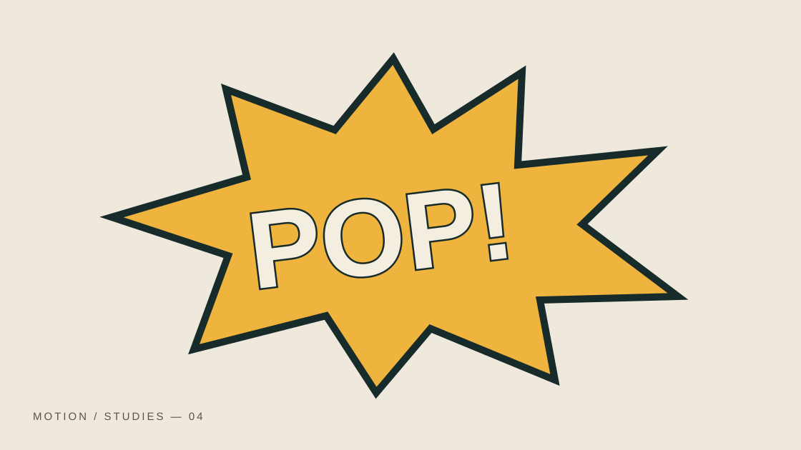

Построй кадр как выразительную комикс-панель: крупный силуэт, контрастные плашки и уверенная обводка. До удара или прыжка дай подготовку, затем короткое главное действие и догоняющий акцент. Слова-эффекты помогают событию, но не закрывают героя.

## 05-pixel — Пиксельная механика
Коллекция: Базовые техники. Превью: авторский SVG.
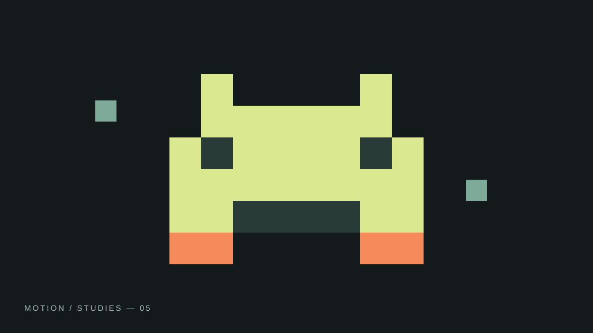

Выбери единую низкоразрешённую сетку и палитру. Движение строится сменой выразительных поз и целочисленными сдвигами, масштабирование сохраняет резкие границы. Используй игровые правила появления, контакта и результата; не смешивай разные размеры пикселя без причины.

## 06-typography — Слова как действие
Коллекция: Базовые техники. Превью: авторский SVG.
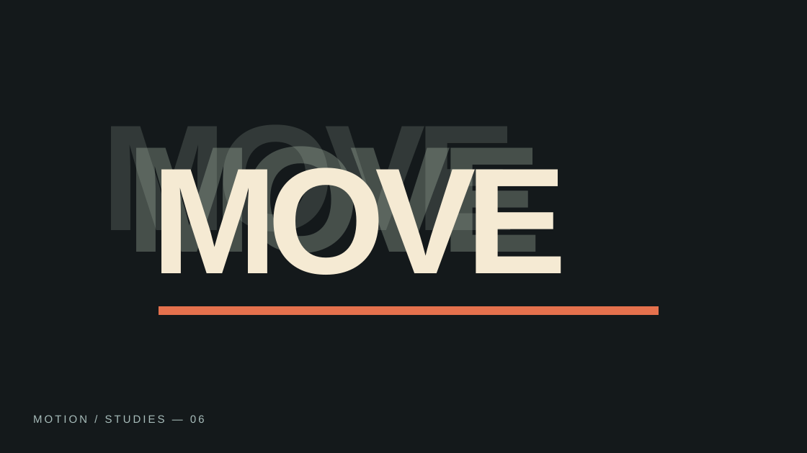

Сделай главным героем мысль, выраженную короткой фразой. Иерархия размера, веса и положения ведёт чтение, а появление слов раскрывает аргумент. Удерживай смысловые состояния; маски и трансформации выбирай по значению слов, а не одинаково для всей строки.

## 07-neon — Световая схема
Коллекция: Базовые техники. Превью: авторский SVG.
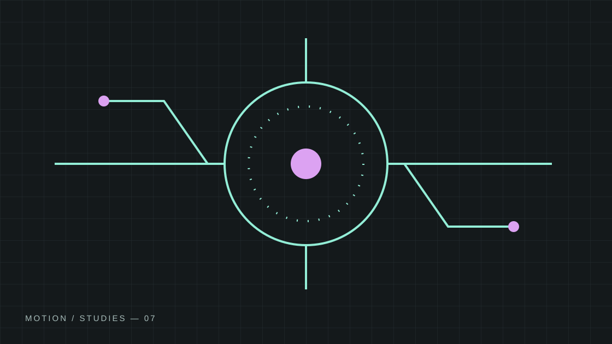

Рисуй информацию светящимися траекториями на тёмном поле. Импульс идёт по связи, открывает узел и оставляет стабильный результат. Несколько оттенков задают роли данных; свечение поддерживает контур, не превращает детали в белое пятно.

## 08-premium-3d — Скульптурный объект
Коллекция: Базовые техники. Превью: авторский SVG.
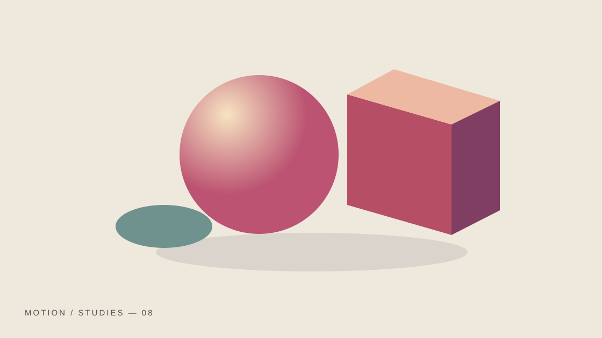

Раскрой характер одного объёмного героя через силуэт, материал и свет. Движение показывает новую грань или функцию, окружение даёт масштаб и контакт. Чередуй выразительный пространственный жест с читаемым опорным кадром; отражения не заменяют содержание.

## 09-saas — Продуктовая история
Коллекция: Базовые техники. Превью: авторский SVG.
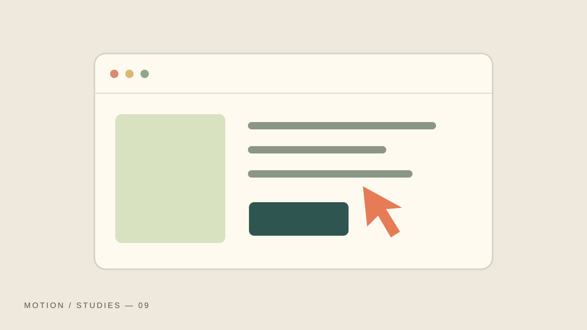

Покажи, как конкретное действие пользователя меняет состояние продукта и приводит к понятной пользе. Курсор или подсветка ведёт внимание, интерфейс остаётся читаемым. Сохраняй последовательность действия и результата; неизвестные возможности продукта не выдумывай.

## 13-swiss-grid — Швейцарская сетка
Коллекция: Экспериментальные направления. Превью: сгенерированная иллюстрация.
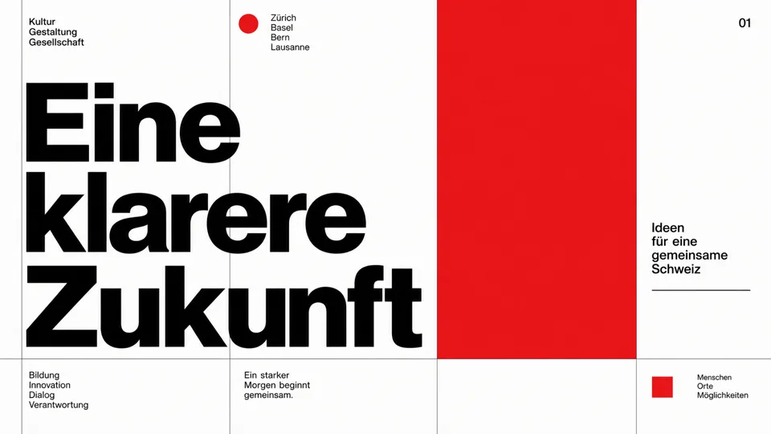

Стиль — швейцарский модернизм: строгая модульная сетка, крупный нейтральный гротеск, чёрный, белый и один красный акцент. Блоки перемещаются вдоль колонок, строки раскрываются масками; ритм строится на контрасте короткого сдвига и читаемой паузы. Без пружин и декоративного шума.

## 14-clay — Пластилиновый мир
Коллекция: Экспериментальные направления. Превью: сгенерированная иллюстрация.
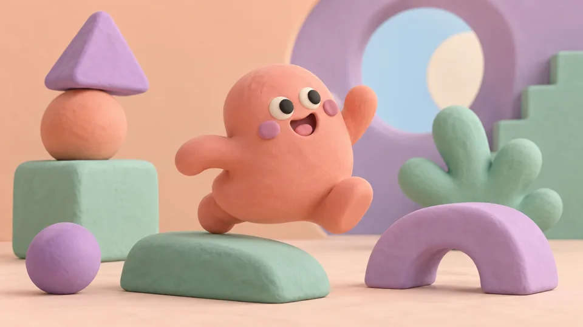

Стиль — пластилиновый 3D: матовые округлые формы, следы ручной лепки, тёплая пастель и контактные тени. Персонаж сначала сжимается перед прыжком, вытягивается в полёте и догоняет корпус мягкими деталями; объём сохраняется. Не заменяй характер материала одинаковым bounce у всех объектов.

## 15-isometric — Изометрический мир
Коллекция: Экспериментальные направления. Превью: сгенерированная иллюстрация.
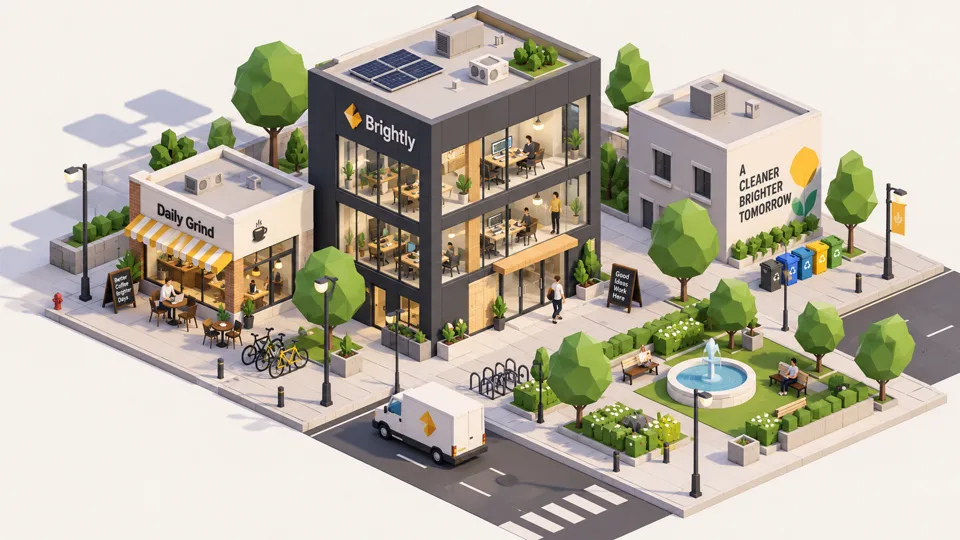

Стиль — изометрическая диорама: параллельные оси, миниатюрный мир на платформе, ясные силуэты и ограниченная палитра. При неподвижной камере внутри работают транспорт, лифты и механизмы; появление объектов идёт по причинной цепочке. Сохраняй проекцию, не превращай её в случайный перспективный облёт.

## 16-type-extrusion — Объёмная типографика
Коллекция: Экспериментальные направления. Превью: сгенерированная иллюстрация.
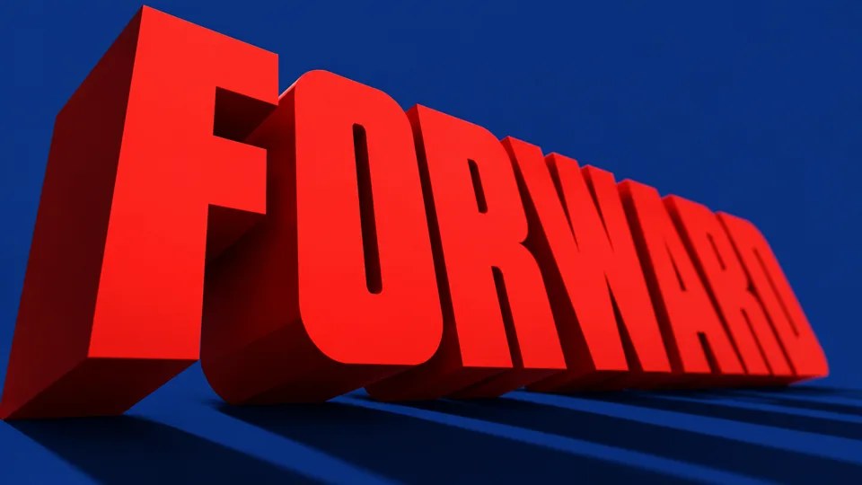

Главный герой — слово с настоящей 3D-экструзией: видимые боковины, насыщенный цвет и направленный свет. Буквы раскрывают толщину поворотом, проходят мимо камеры и собираются в читаемую фразу. Держи смысловой кадр без движения; не деформируй буквы до потери чтения.

## 17-blueprint — Инженерный чертёж
Коллекция: Экспериментальные направления. Превью: сгенерированная иллюстрация.
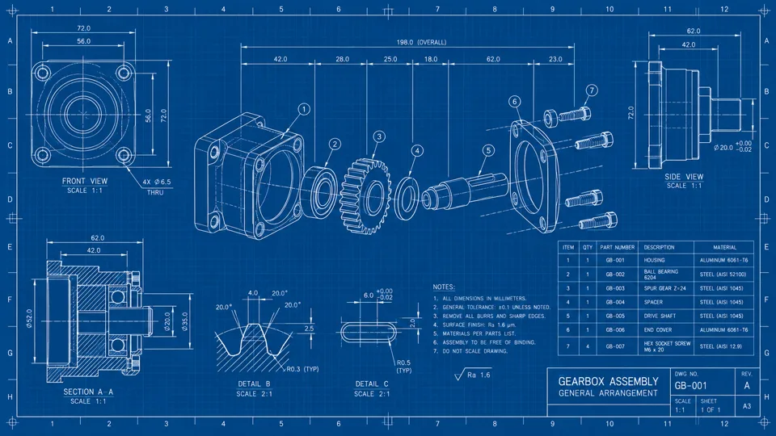

Стиль — инженерный чертёж: тонкие светлые линии на синем поле, сетка, выноски и условные размеры. Сначала строятся опорные оси, затем контуры и узлы; детали расходятся в разнесённый вид и собираются обратно. Цифры демонстрационные, если не даны данные; не выдавай рисунок за рабочую техническую документацию.

## 18-risograph — Ризограф
Коллекция: Экспериментальные направления. Превью: сгенерированная иллюстрация.
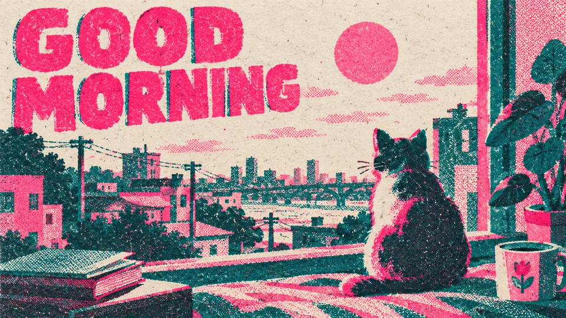

Стиль — ризограф: бумажное зерно, два плашечных цвета, полутон и небольшой сдвиг приводки. Цветовые слои последовательно накладываются, перекрытия меняют тон, акцент печатается отдельным ударом. Фактура привязана к носителю, а не прыгает случайным шумом; без глянца и свечения.

## 19-y2k — Y2K: хром и стекло
Коллекция: Экспериментальные направления. Превью: сгенерированная иллюстрация.
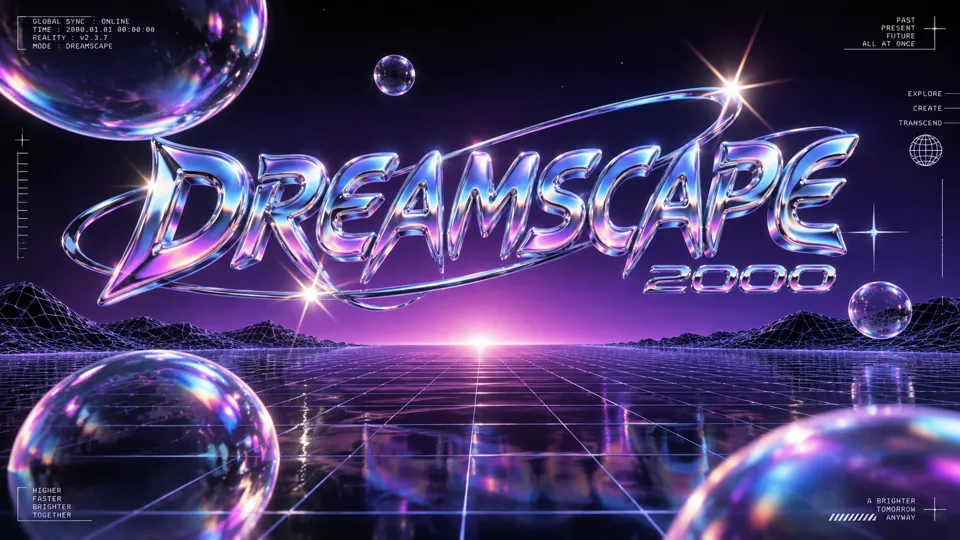

Стиль — ретрофутуризм Y2K: хромовые буквы, стеклянные пузыри, иридесцентные блики и тонкая цифровая сетка. Камера раскрывает отражения одним проездом, объекты вращаются с разной инерцией, световой акцент подчёркивает смену состояния. Не смешивай все эффекты сразу; текст остаётся главным.

## 20-stop-motion — Тактильный стоп-моушен
Коллекция: Экспериментальные направления. Превью: сгенерированная иллюстрация.
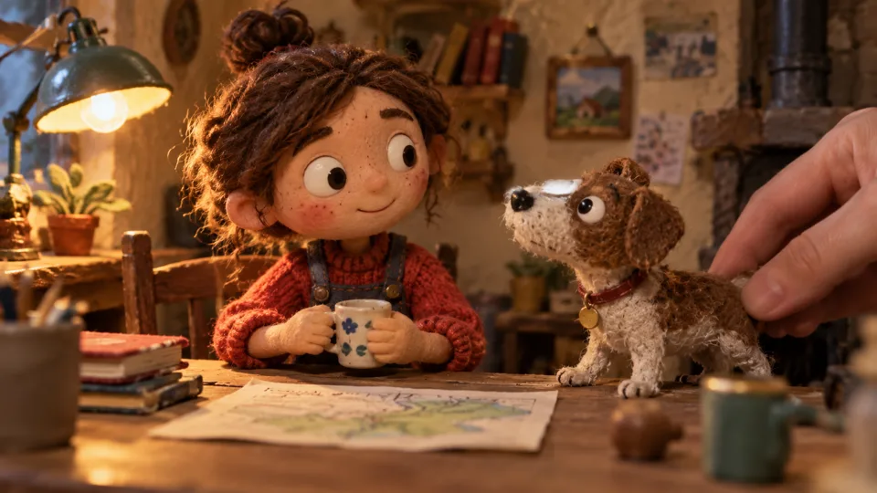

Стиль — кукольный стоп-моушен: войлок, ткань, картон и ручная миниатюра под тёплым практическим светом. Действие складывается из удержанных поз и небольших покадровых сдвигов; материал и тени сохраняют непрерывность. Не добавляй видимую руку аниматора, если этого не требует сюжет.

## 21-glitch — Управляемый глитч
Коллекция: Экспериментальные направления. Превью: сгенерированная иллюстрация.
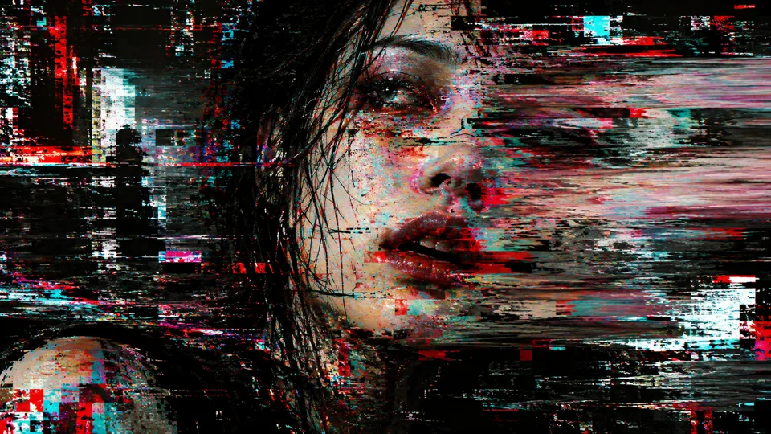

Стиль — цифровой сбой: локальное RGB-расслоение, полосы смещения, блоки сжатия и след предыдущего кадра. Короткий сбой подготавливает смысловую смену, после него изображение стабилизируется. Без постоянного мерцания: избегай частых контрастных вспышек, сохраняй читаемые паузы и спокойную альтернативу.

## 22-physics — Материал и физика
Коллекция: Экспериментальные направления. Превью: сгенерированная иллюстрация.
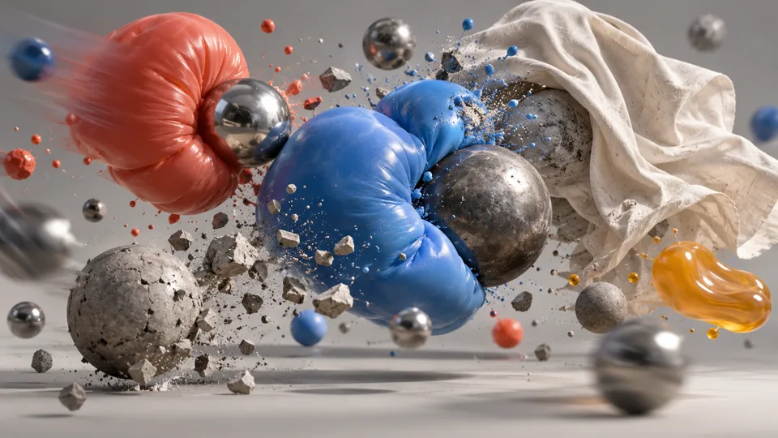

Стиль — физическая композиция: резина, ткань и твёрдые тела имеют разный вес, трение и упругость. Покажи подготовку, контакт, деформацию и затухание; вторичные детали догоняют основной импульс. Проверяй столкновения и сохранение массы; набор случайно летающих шаров не заменяет постановку.

## 23-data — Данные в движении
Коллекция: Экспериментальные направления. Превью: сгенерированная иллюстрация.
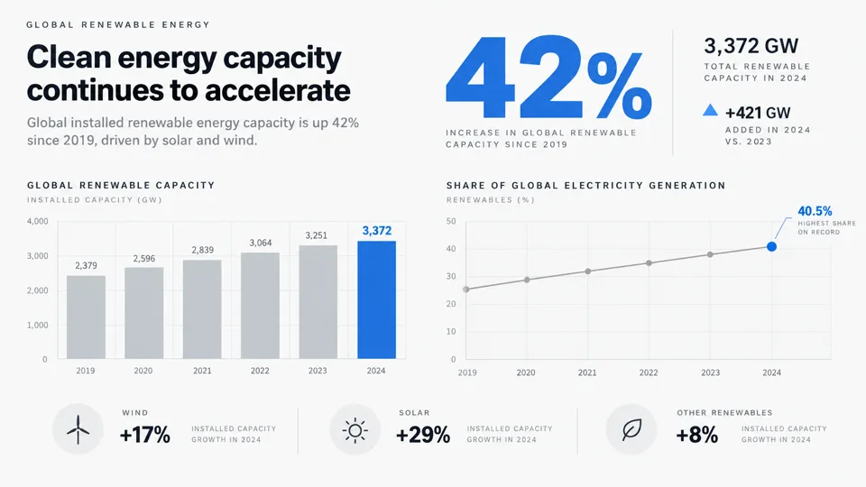

Стиль — редакционная инфографика: точные оси, нейтральная сетка и один акцент. Данные раскрываются в порядке вопрос → сравнение → вывод; счётчики и графики движутся синхронно, подписи остаются неподвижными для чтения. Используй только предоставленные или явно демонстрационные цифры, не искажай масштаб ради эффекта.

## 24-type-grid — Кинетическая матрица
Коллекция: Экспериментальные направления. Превью: сгенерированная иллюстрация.
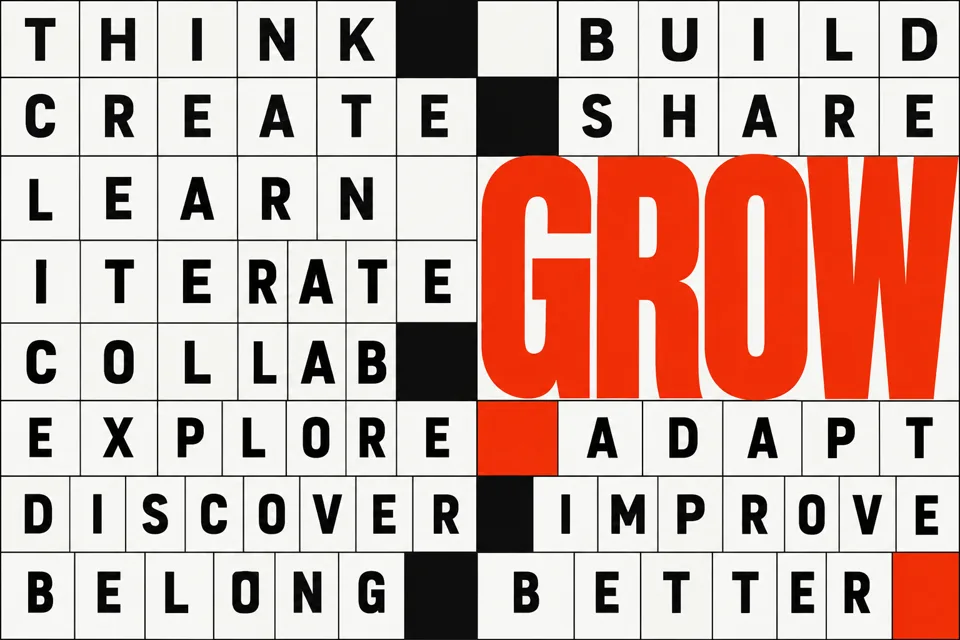

Стиль — типографическая матрица: буквы и плашки занимают модульные ячейки, чёрный и белый дополнены одним цветом. Волна перемещения проходит по рядам, одно слово нарушает сетку и становится героем, затем структура собирается заново. Задай один порядок задержек; не двигай каждую букву независимо.

## Пространство — отдельный модификатор

### 2D
Плоская сцена: ясные силуэты, перекрытия и движение вдоль плоскости. Пространственный эффект не обязателен.

### 2,5D
Раздели композицию на планы. Перекрытия, контактные тени и разная скорость смещения создают глубину без настоящего объёмного объекта.

### 3D
Построй объём со связанными гранями, светом и перспективой. Пространственное движение должно раскрывать форму или смысл, а не вращать камеру ради эффекта.
